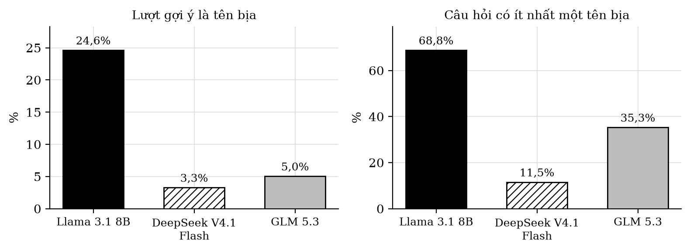
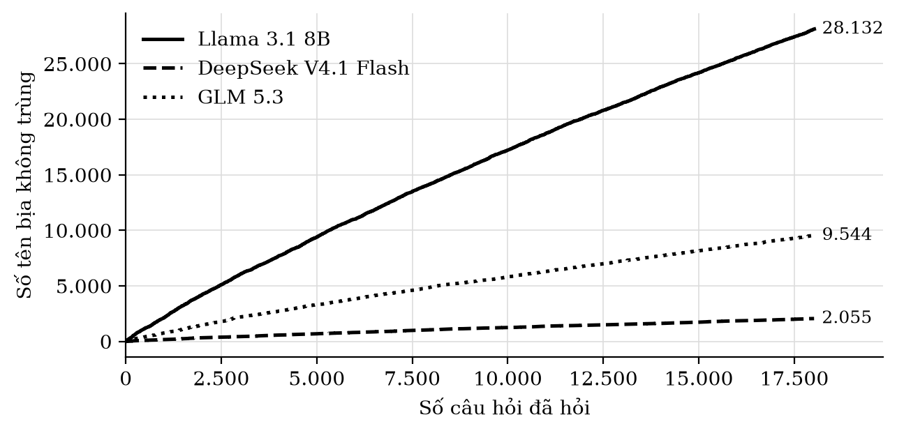
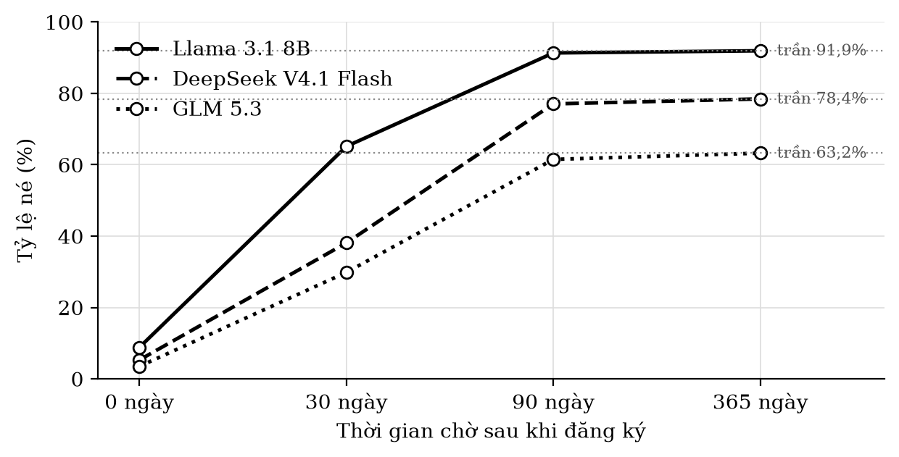
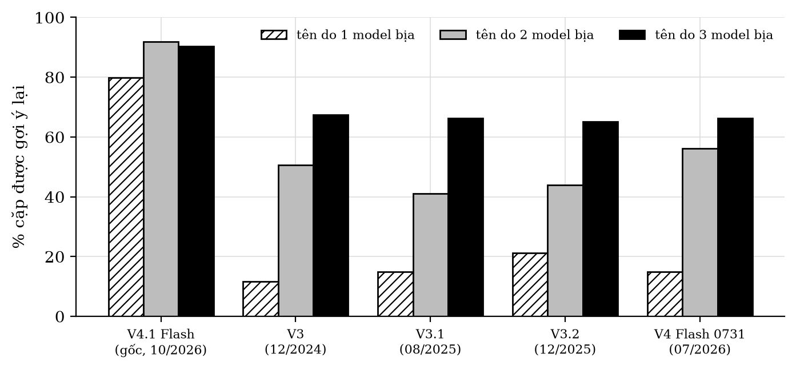
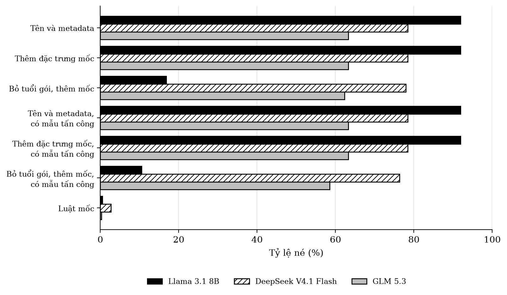

# Báo cáo tiến độ: dữ liệu, gắn nhãn và thử nghiệm sơ bộ bộ phát hiện slopsquatting

**Đề tài:** Tăng cường độ bền vững adversarial cho hệ thống phát hiện tấn công Slopsquatting (Package Hallucination) trong mã nguồn sinh bởi mô hình ngôn ngữ lớn

**Giảng viên hướng dẫn:** TS. Mai Đức Thọ · **Ngày:** 15/11/2026 · **Kỳ báo cáo:** 07/11–14/11/2026

## Tóm tắt

Trong kỳ này, đề tài đã xây công cụ thu thập dữ liệu, thu câu trả lời của ba LLM trên 18.033 câu hỏi, gắn nhãn các tên gói, và chạy thử nghiệm sơ bộ cho bộ phát hiện và cho tấn công né tránh. Các kết quả chính:

1. Tỷ lệ lượt gợi ý là tên bịa khác nhau theo model: Llama 3.1 8B 24,6%, GLM 5.3 5,0%, DeepSeek V4.1 Flash 3,3%. Có 760 tên bịa do cả ba model cùng gợi ý.
2. Bộ phát hiện chỉ dùng tên bắt được 20,1% tên bịa ở mức báo nhầm 1%. Khi kiểm thử trên tên do một LLM gợi ý mà tên của LLM đó không có trong dữ liệu huấn luyện, tỷ lệ này còn 3,4–15,1%.
3. Bộ phát hiện dùng thêm metadata (tầng 2) phân biệt chủ yếu nhờ tuổi gói: nó báo nhầm 99,1% gói thật mới đăng, và chỉ bắt được 10,8% trong 120 tên bịa đã bị đăng ký thật. Kẻ tấn công đăng ký tên rồi chờ 90 ngày là đạt gần mức né tối đa.
4. Tên bịa chỉ một model sinh ra phần lớn không còn được gợi ý ở các phiên bản khác của cùng họ model. Tên bịa do cả ba model cùng sinh ra thì khoảng 2/3 vẫn được gợi ý lại.
5. Trong các gói có thật mà LLM gợi ý, 693 gói ra đời sau mốc dữ liệu của mọi model đã gợi ý chúng. Kiểm tra từng gói cho thấy 141 gói (20,3%) là gói rỗng hoặc chiếm tên.
6. Huấn luyện có mẫu tấn công giảm tỷ lệ né xuống 0,5–4,0% trước đúng kiểu tấn công đã mô phỏng, nhưng kẻ tấn công chép metadata của gói thật với 10 USD vẫn né được gần mức tối đa. Luật "cảnh báo gói đăng ký sau mốc dữ liệu của model" không bị ảnh hưởng bởi thời gian chờ hay ngân sách. Đổi lại, luật báo nhầm 6,5% gói thật do Llama gợi ý và bị vượt qua nếu kẻ tấn công đăng ký tên trước mốc.

Mọi số liệu dưới đây lấy từ dữ liệu đã thu, với snapshot danh sách gói PyPI ngày 12/11/2026 (937.845 project).

## 1. Dữ liệu đã thu

### 1.1. Cách thu

Công đoạn thu thập gồm tám việc, làm theo thứ tự:

1. **Chuẩn bị câu hỏi:** dùng 18.033 câu hỏi lập trình Python không trùng nhau của Spracklen và cộng sự (2025).
2. **Hỏi LLM:** gửi từng câu hỏi cho ba model: Llama 3.1 8B Instruct, DeepSeek V4.1 Flash bản 1017 và GLM 5.3. Mỗi câu hỏi theo ba cách, như Spracklen và cộng sự (2025):
   - nhờ viết code (temperature 0,7);
   - hỏi "cần gói nào để chạy đoạn code này" (temperature 0,01, tối đa 64 token);
   - hỏi "gói nào hữu ích cho bài toán này" (temperature 0,01, tối đa 64 token).

   Chế độ suy nghĩ của DeepSeek và GLM được tắt. Llama và DeepSeek chạy qua dịch vụ DeepInfra. GLM chạy trên máy nội bộ, sau đó kết quả được gộp vào cùng một cơ sở dữ liệu.
3. **Lấy tên gói từ câu trả lời:** tìm trong lệnh `pip install` và trong các câu trả lời dạng danh sách.
   - Mỗi tên được đưa về một dạng chuẩn theo đúng quy tắc của PyPI; ví dụ `Vector_Cache` và `vector-cache` là một tên.
   - Tên module thư viện chuẩn (`os`, `json`…) được tách thành nhãn riêng và không tính vào tỷ lệ tên bịa.
4. **Tra PyPI:** tải danh sách 937.845 project đang có trên PyPI (ngày 12/11/2026) và xem mỗi tên đã có hay chưa. Với tên chưa có, kiểm tra tên đó còn đăng ký được không, theo đúng luật trong mã nguồn của PyPI.
5. **Lấy metadata của gói có trên PyPI** (32.954 gói), từ năm nguồn:
   - PyPI: các bản phát hành, link mã nguồn, người duy trì;
   - thông tin xác minh nguồn của PyPI (provenance);
   - lượt tải 30 ngày từ ClickPy, không tính các công cụ sao chép toàn bộ PyPI;
   - lịch sử tải lên từ ClickPy, kể cả các bản đã bị xóa;
   - số sao và ngày tạo kho mã trên GitHub.
6. **Gắn nhãn:** một bộ luật xếp mỗi tên vào một nhóm: tên thật, tên bịa chưa có trên PyPI, tên bịa đã bị đăng ký, gói giữ chỗ, gói độc hại đã biết. Các trường hợp luật không đủ bằng chứng (442 gói) được kiểm chứng thủ công (xem mục "Luật mốc dữ liệu và kiểm chứng thủ công").
7. **Hỏi lại:** với mỗi model, chọn 250 tên bịa và hỏi lại câu gốc 10 lần, để đo mức lặp lại của tên bịa (xem mục "Dữ liệu hỏi lại").
8. **Hỏi các phiên bản model khác:** hỏi cùng các câu đó ở hai phiên bản Llama và bốn phiên bản DeepSeek, để đo độ bền của tên bịa qua các phiên bản (xem mục "Dữ liệu hỏi lại" và "Độ bền của tên bịa qua các phiên bản").

Ngoài ra, hai tập gói đối chứng được lấy từ PyPI để đo tỷ lệ báo nhầm của bộ phát hiện: 3.000 gói mới đăng (phát hành lần đầu 08–10/2026) và 10.000 gói chọn ngẫu nhiên.

### 1.2. Số liệu theo model

Số liệu tính trên lần hỏi gốc của mỗi câu hỏi; lượt gợi ý gồm cả ba tác vụ.

| | Llama 3.1 8B | DeepSeek V4.1 Flash | GLM 5.3 |
|---|---|---|---|
| Câu hỏi có ít nhất một tên gói | 17.894 | 17.492 | 17.903 |
| Lượt gợi ý tên gói | 208.190 | 104.151 | 320.994 |
| Lượt gợi ý trung bình mỗi câu hỏi | 11,6 | 6,0 | 17,9 |
| Tỷ lệ lượt gợi ý là tên bịa | 24,6% | 3,3% | 5,0% |
| Tỷ lệ câu hỏi có ít nhất một tên bịa | 68,8% | 11,5% | 35,3% |
| Tên không trùng | 38.737 | 9.652 | 23.017 |
| Tên bịa không trùng | 28.132 | 2.055 | 9.544 |

<em>Bảng 1. Số liệu thu thập theo model, lần hỏi gốc</em>

<em>Hình 1. Tỷ lệ tên bịa theo model, lần hỏi gốc</em>

GLM bịa ít trên mỗi lượt gợi ý (5,0%), nhưng mỗi câu trả lời liệt kê nhiều tên (17,9 tên), nên 35,3% câu hỏi vẫn có ít nhất một tên bịa.

<em>Hình 2. Số tên bịa không trùng tích lũy theo số câu hỏi</em>

Các câu hỏi được xếp theo một thứ tự ngẫu nhiên cố định. Với cả ba model, số tên bịa mới vẫn tăng đều đến hết 18.033 câu hỏi, chưa chững lại. Nghĩa là hỏi thêm câu hỏi thì vẫn còn ra tên bịa mới.

Tên bịa ở đây gồm tên chưa có trên PyPI và tên bịa đã bị người khác đăng ký (xem mục "Các nhãn"). Để đối chiếu, Spracklen và cộng sự (2025) báo cáo tỷ lệ trung bình 21,7% với LLM mã nguồn mở và 5,2% với LLM thương mại, cũng tính theo lượt gợi ý. Hai cách tính có thể khác nhau ở chỗ xử lý tên thư viện chuẩn.

Số tên bịa trùng giữa các model:

| Cặp model | Tên bịa chung |
|---|---|
| Llama và GLM | 2.329 |
| DeepSeek và GLM | 1.105 |
| Llama và DeepSeek | 1.057 |
| Cả ba model | 760 |

<em>Bảng 2. Tên bịa trùng giữa các model</em>

### 1.3. Dữ liệu hỏi lại

- **Hỏi lại cùng model:** mỗi model chọn 250 cặp (tên bịa, câu hỏi gốc), rồi hỏi lại câu gốc 10 lần theo cả ba tác vụ. Dữ liệu này cho biết LLM lặp lại tên bịa thường đến mức nào và sinh ra những biến thể nào. Phần hỏi lại của GLM 5.3 chạy qua DeepInfra thay vì máy nội bộ; hai nơi chạy cho câu trả lời khác nhau (độ trùng tên trung bình 0,38 trên 100 câu thử), nên tỷ lệ lặp lại của GLM không so trực tiếp được với hai model còn lại.
- **Hỏi các phiên bản khác cùng họ:** cùng các câu hỏi đã chọn được hỏi lại ở sáu phiên bản khác (bảng 13), mỗi câu 10 lần, để đo độ bền của tên bịa qua các phiên bản.

Mọi lượt gọi model đều hoàn tất, không còn câu nào lỗi.

### 1.4. Cơ sở dữ liệu

Toàn bộ dữ liệu nằm trong một file SQLite, `data/slop.sqlite`, dung lượng 4,2 GB.
- File không đưa lên git, vì có danh sách tên bịa chưa ai đăng ký; công bố danh sách này cần làm theo quy trình công bố có trách nhiệm.
- Có thể xem bằng notebook `notebooks/phan-tich-du-lieu.ipynb`, hoặc phần mềm DB Browser for SQLite.

Mỗi bước của quy trình thu thập ghi kết quả vào một nhóm bảng; bước sau đọc kết quả của bước trước:

| Nhóm | Bảng | Mỗi dòng là | Số dòng |
|---|---|---|---|
| Câu hỏi | `prompts` | một câu hỏi | 18.033 |
| | `prompt_tags` | một nhãn phân nhóm của câu hỏi (ví dụ thuộc bộ Spracklen, được chọn để hỏi lại) | 36.784 |
| Câu trả lời | `generations` | một câu trả lời của một model cho một câu hỏi, ở một tác vụ, ở một lần hỏi | 225.144 |
| Tên gói trích được | `mentions` | một tên gói trích từ một câu trả lời, kèm cách trích (`pip install`, danh sách, `import`) | 981.375 |
| | `v_mentions` (view) | như `mentions`, kèm sẵn model, câu hỏi và lần hỏi | – |
| PyPI | `pypi_index` | một project có trên PyPI tại ngày 12/11/2026 | 937.845 |
| | `package_status` | kết quả tra một tên: có trên PyPI không, nếu chưa có thì đăng ký được không, và lý do | 61.993 |
| Metadata | `metadata_raw` | dữ liệu thô của một gói từ một nguồn (PyPI, provenance, lượt tải, lịch sử tải lên, GitHub) | 164.770 |
| | `package_features` | các đặc trưng đã tính cho một gói có trên PyPI (tuổi, lượt tải, sao, số bản phát hành…) | 32.954 |
| Nhãn | `labels` | nhãn của một tên theo một phiên bản bộ luật, kèm luật đã quyết định và bằng chứng | 182.106 |
| | `known_lists` | một tên trong các danh sách công khai: gói độc hại (OSV 12.022, DataDog 1.834), tên bịa đã công bố (0pstech 1.102, DepScope 20) | 14.978 |
| | `selections` | một cặp (tên bịa, câu hỏi) được chọn để hỏi lại, 250 cặp mỗi model | 750 |
| | `name_samples` | một gói trong hai tập mẫu dùng để đo báo nhầm: 3.000 gói mới đăng, 10.000 gói ngẫu nhiên | 13.000 |
| Quản lý | `runs` | một lần chạy một bước, kèm cấu hình và thời gian | 170 |

<em>Bảng 3. Các bảng trong cơ sở dữ liệu</em>

Một vài điểm cần lưu ý khi đọc bảng 3:
- **Các bảng nối với nhau qua ba khóa:**
  - `prompt_id`: câu hỏi;
  - `gen_id`: câu trả lời;
  - `norm_name`: tên gói đã chuẩn hóa theo quy tắc của PyPI.

  Ví dụ, để biết model nào gợi ý một tên bịa ở câu hỏi nào, đi từ `labels` sang `mentions` theo `norm_name`, rồi sang `generations` theo `gen_id`.
- **Mỗi khóa là mã băm của nội dung.** Chạy lại một bước không tạo dòng trùng, và dữ liệu từ máy khác (máy nội bộ chạy GLM) gộp vào được mà không đụng nhau.
- **Câu trả lời lỗi cũng được giữ**, kèm nội dung lỗi, và được chạy lại ở lần sau. Hiện không còn câu trả lời nào lỗi.
- **Bảng `labels` giữ cả ba phiên bản bộ luật** (rules-v1, rules-v2, rules-v3), mỗi phiên bản khoảng 60.000 tên. Báo cáo dùng rules-v3.
- **Bảng `metadata_raw` lưu nguyên dữ liệu thô** của 5 nguồn cho 32.954 gói. Vì vậy có thể tính lại đặc trưng mà không cần tải lại.

Số câu trả lời theo cấu hình model:

| Cấu hình model | Vai trò | Số câu trả lời |
|---|---|---|
| Llama 3.1 8B | Model chính: 18.033 câu × 3 tác vụ, cộng phần hỏi lại | 60.714 |
| DeepSeek V4.1 Flash | Model chính, như trên | 60.363 |
| GLM 5.3, máy nội bộ | Model chính: 18.033 câu × 3 tác vụ | 54.099 |
| GLM 5.3, qua DeepInfra | Phần hỏi lại của GLM | 6.990 |
| Llama 3.3 70B, Llama 4 Scout | Phiên bản khác của Llama, đo độ bền | 7.350 mỗi model |
| DeepSeek V3, V3.1, V3.2, V4 Flash 0731 | Phiên bản khác của DeepSeek, đo độ bền | 6.960 mỗi model |
| Qwen 3.5 4B | Chạy thử ban đầu trên máy kali, không dùng trong phân tích | 438 |

<em>Bảng 4. Số câu trả lời theo cấu hình model</em>

## 2. Gắn nhãn và kiểm soát chất lượng nhãn

### 2.1. Các nhãn

Mỗi tên gói được gắn một nhãn theo chuỗi luật áp theo thứ tự (bộ luật hiện tại: rules-v3).

| Nhãn | Ý nghĩa | Số tên |
|---|---|---|
| Tên bịa chưa có trên PyPI | Tầng 1 (tra PyPI) bắt được | 41.365 |
| Tên thật | Gói bình thường | 19.436 |
| Gói giữ chỗ | Bản giữ chỗ hoặc project rỗng | 656 |
| Thư viện chuẩn | Tên module có sẵn trong Python | 313 |
| Tên bịa đã bị đăng ký | Có trên PyPI, nhưng có bằng chứng do người khác đăng ký theo tên LLM bịa | 155 |
| Gói độc hại đã biết | Có trong danh sách OSV hoặc DataDog, và toàn bộ gói là độc hại | 67 |

<em>Bảng 5. Phân bố nhãn theo tên không trùng, bộ luật rules-v3</em>

Bảng 5 đếm tên không trùng, gồm cả tên trích từ lệnh `import` và tên ở các lần hỏi lại. Xét theo tên không trùng, tên bịa nhiều hơn tên thật khoảng 2 lần. Xét theo lượt gợi ý thì ngược lại: tên thật chiếm 86,5% trong 633.335 lượt gợi ý ở lần hỏi gốc (Llama 72,3%, DeepSeek 95,0%, GLM 93,0%).

Có hai lý do cho sự chênh lệch này:
- Tên thật lặp lại nhiều: 100 tên thật hay gặp nhất chiếm 50,4% lượt gợi ý tên thật.
- Tên thật trùng nhiều giữa các model: 3.978 tên thật được cả ba model gợi ý, so với 760 tên bịa.

### 2.2. Các lỗi đã phát hiện và sửa

Kiểm tra mẫu nhãn và dữ liệu đã phát hiện năm lỗi. Mỗi lỗi được sửa trong code và có test kèm theo.

| Lỗi | Bằng chứng | Cách sửa | Ảnh hưởng |
|---|---|---|---|
| Gói phổ biến chỉ bị nhiễm vài phiên bản bị gắn là gói độc hại | litellm có 3 phiên bản độc hại trên 990 phiên bản | Chỉ gắn nhãn độc hại khi toàn bộ gói là độc hại, hoặc gói đã bị gỡ | 6 gói (litellm, mistralai, num2words, ultralytics, lightning, elementary-data) trở về nhãn tên thật |
| Luật gói giữ chỗ bắt cả gói thật có chữ "deprecated" trong README | Trên mẫu 40 tên, khoảng 2 tên đúng là gói giữ chỗ (peft, natsort, amqp bị bắt nhầm) | Chỉ so mẫu trên phần tóm tắt, và trên phần mô tả khi mô tả không quá 400 ký tự | Số tên khớp luật giảm từ 996 xuống 156; 830 tên trở về nhãn tên thật |
| Ngày phát hành đầu sai với gói đã xóa bản cũ | PyPI chỉ còn các bản chưa bị xóa: PySimpleGUI có từ 07/2018 nhưng hiện như phát hành lần đầu 03/2025 | Lấy lần tải lên sớm nhất từ lịch sử của ClickPy, kể cả bản đã xóa | 632 tên lệch quá 30 ngày, trong đó 378 tên lệch quá 1 năm |
| Từ nối bị đọc thành tên gói | "None, however, …" cho ra tên `however` | Bỏ các từ nối khỏi danh sách tên | 33 lượt gợi ý bị loại |
| Tên bịa đã bị đăng ký lâu hoặc đã có nhiều lượt tải bị gắn là tên thật | Luật cũ chỉ bắt gói dưới 180 ngày tuổi và dưới 1.000 lượt tải/tháng | Thêm luật dựa trên mốc dữ liệu của model (xem mục "Luật mốc dữ liệu và kiểm chứng thủ công") | 141 gói được gắn nhãn tên bịa đã bị đăng ký, 3 gói được gắn nhãn gói giữ chỗ |

<em>Bảng 6. Lỗi nhãn đã phát hiện và cách sửa</em>

### 2.3. Luật mốc dữ liệu và kiểm chứng thủ công

Luật mới áp dụng cho gói có trên PyPI mà lần tải lên đầu tiên muộn hơn mốc dữ liệu của mọi model đã gợi ý gói đó, cộng thêm 30 ngày. Model không thể biết một gói ra đời sau mốc dữ liệu của nó; nếu model vẫn gợi ý đúng tên, tên đó do model bịa ra, rồi về sau mới có người đăng ký.

Mốc dữ liệu được lấy như sau:

| Model | Mốc | Nguồn |
|---|---|---|
| Llama 3.1 8B, Llama 3.3 70B | 12/2023 | Thông tin model do Meta công bố |
| Llama 4 Scout | 08/2024 | Thông tin model do Meta công bố |
| DeepSeek V3 | 07/2024 | Cộng đồng (DataLearner: mốc chính thức cuối cùng của DeepSeek) |
| DeepSeek V3.1 | 07/2025 | Cộng đồng (OpenRouter ghi 03/2025, Digit ghi 07/2025; lấy mốc muộn hơn) |
| DeepSeek V4.1 Flash | 03/2026 | Cộng đồng ("đầu 2026", theo câu trả lời của chính model) |
| GLM 5.3 | 12/2025 | Cộng đồng (innfactory: "cuối 2025") |

<em>Bảng 7. Mốc dữ liệu của các model</em>

DeepSeek và Zhipu không công bố mốc dữ liệu. Các mốc ghi "cộng đồng" chưa được kiểm chứng. Khi các nguồn lệch nhau, mốc muộn hơn được chọn để luật gắn cờ ít hơn. Với hai phiên bản không có thông tin mốc (DeepSeek V3.2, V4 Flash 0731), luật không áp dụng cho các tên mà chúng gợi ý.

Cách phân loại theo bằng chứng được đặt ra trước khi xem kết quả:
- **Gói rỗng hoặc chiếm tên:** tóm tắt trống hoặc là câu mẫu; hoặc chỉ có một bản phát hành với số phiên bản kiểu 0.0.0 và mô tả ngắn.
- **Gói hợp lệ:** thuộc một tổ chức trên PyPI; hoặc có link kho mã đã được PyPI xác minh; hoặc có ít nhất 5 bản phát hành và 10 sao GitHub; hoặc có ít nhất 100.000 lượt tải/tháng.
- **Còn lại:** kiểm chứng thủ công, gồm xem metadata, dung lượng file, mô tả và kho mã. Với 37 gói chưa đủ bằng chứng, file phát hành được tải về và đọc code, không cài đặt.

Kết quả với 693 gói khớp luật:

| Phân loại | Theo luật | Kiểm chứng thủ công | Tổng |
|---|---|---|---|
| Gói rỗng hoặc chiếm tên | 110 | 31 | 141 (20,3%) |
| Gói giữ chỗ phòng vệ do tổ chức đặt (Azure SDK, conda-forge) | 0 | 3 | 3 (0,4%) |
| Dự án có code thật, trùng tên sau mốc | 141 | 408 | 549 (79,2%) |

<em>Bảng 8. Phân loại gói ra đời sau mốc dữ liệu</em>

Một số trường hợp tiêu biểu:
- `python-dependency-injector` chỉ 1,8 KB, không có mô tả, nhưng dùng số phiên bản 4.41.0 trùng với gói thật `dependency-injector`.
- `restructuredtext` được Llama 3.1 gợi ý ở 81 câu hỏi; gói này là một template rỗng đăng ký 03/2025.
- `cryptography-fernet` tự mô tả là "an example of a Dependency Hallucination", tức do nhà nghiên cứu đăng ký để minh họa.

Có 3 gói chạy lệnh lúc cài đặt hoặc tự cài thêm gói khác (`nltk-punkt`, `hython`, `libz`); đọc code không thấy dấu hiệu độc hại.

Số gói khớp luật phụ thuộc vào mốc và khoảng đệm. Dời mọi mốc sớm hoặc muộn 6 tháng thì số gói thay đổi trong khoảng 516–878, so với 691 khi giữ nguyên mốc. Khoảng đệm 30, 90 và 180 ngày cho lần lượt 691, 629 và 546 gói.

### 2.4. Phần nhãn chưa duyệt

Còn 667 tên được gắn cờ cần duyệt nhưng chưa duyệt:
- 491 project không có file phát hành nào;
- 162 tên khớp mẫu gói giữ chỗ;
- 9 tên khớp luật "mới và ít lượt tải";
- 5 tên có trong danh sách tên bịa đã công bố.

## 3. Kết quả thử nghiệm

### Các bộ phát hiện đã thử

Mọi bộ phát hiện ở phần này thuộc tầng 2, tức dành cho tên đã có trên PyPI. Mỗi bộ nhận vào thông tin của một gói và cho ra một điểm "đáng ngờ"; điểm vượt ngưỡng thì cảnh báo.

Đặc trưng (thông tin đưa vào mô hình) chia làm bốn loại:
- **Đặc trưng từ tên (10 đặc trưng):**
  - độ dài tên, số từ (tách theo dấu `-`), số chữ số, tỷ lệ nguyên âm, độ dài từ dài nhất;
  - tên có bắt đầu bằng `py` hoặc chứa `python` không;
  - với tên nhiều từ: từ đầu tiên có phải tên một gói trên PyPI không, mọi từ có phải tên gói không, bao nhiêu phần các từ là tên gói;
  - với tên nhiều từ: có gói khác trên PyPI trùng chữ cái khi bỏ dấu phân cách không.

  Các đặc trưng này không dùng việc chính tên đó có trên PyPI hay không, vì ở tầng 2 mọi tên đều có trên PyPI.
- **Cụm ký tự của tên:** mọi cụm 2–5 ký tự liên tiếp (n-gram ký tự), có trọng số theo độ hiếm (TF-IDF). Ví dụ `vectorcache` cho ra các cụm `ve`, `vec`, `ect`, `cache`…
- **Metadata (13 đặc trưng):**
  - nhóm tuổi: tuổi gói, số ngày từ lần phát hành gần nhất, tuổi kho GitHub;
  - nhóm hoạt động: lượt tải 30 ngày, số bản phát hành, số file, số sao GitHub;
  - nhóm khai báo: có link GitHub, link kho mã có được PyPI xác minh, số người duy trì, có thuộc tổ chức, độ dài mô tả, có khai báo link dự án.

  Lượt tải và số sao được lấy logarit, để gói có hàng triệu lượt tải không lấn át phần còn lại.
- **Đặc trưng mốc:** số ngày từ mốc dữ liệu của LLM đã gợi ý gói đến ngày gói được đăng ký. Số dương nghĩa là gói ra đời sau mốc.

Hai thuật toán học máy:
- **Logistic Regression (LR):** cộng các đặc trưng theo trọng số học được rồi đổi thành điểm từ 0 đến 1. Mô hình tuyến tính, dễ giải thích. Đặc trưng được chuẩn hóa trước khi đưa vào; hai lớp được cân bằng trọng số vì tên bịa và tên thật có số lượng khác nhau.
- **Gradient Boosting (GB):** ghép 300 cây quyết định nhỏ, mỗi cây tối đa 31 lá, cây sau sửa lỗi của các cây trước (bản HistGradientBoosting của scikit-learn, tốc độ học 0,08). Mô hình học được các điều kiện kết hợp, ví dụ "tuổi dưới 30 ngày và lượt tải dưới 100". Hai lớp cũng được cân bằng trọng số.

| Bộ phát hiện | Đặc trưng đưa vào | Thuật toán | Dùng ở mục |
|---|---|---|---|
| Chỉ tên, n-gram | Cụm ký tự của tên | LR | Bộ phát hiện chỉ dùng tên; Tấn công đăng ký rồi chờ |
| Chỉ tên, đặc trưng thủ công | 10 đặc trưng từ tên | GB | Bộ phát hiện chỉ dùng tên; Tầng 2 dùng metadata |
| Chỉ metadata | 13 đặc trưng metadata | GB | Tầng 2 dùng metadata |
| Tên và metadata | 10 đặc trưng từ tên và 13 đặc trưng metadata | LR, GB | Tầng 2 dùng metadata; Tấn công đăng ký rồi chờ; Đặc trưng mốc, huấn luyện có mẫu tấn công và luật mốc |
| Tên và metadata, bỏ tuổi gói | Như trên, bỏ 3 đặc trưng nhóm tuổi | GB | Tầng 2 dùng metadata; Đặc trưng mốc, huấn luyện có mẫu tấn công và luật mốc |
| Thêm đặc trưng mốc | Tên, metadata và đặc trưng mốc | GB | Đặc trưng mốc, huấn luyện có mẫu tấn công và luật mốc |
| Bỏ tuổi gói, thêm đặc trưng mốc | Tên, metadata trừ nhóm tuổi, và đặc trưng mốc | GB | Đặc trưng mốc, huấn luyện có mẫu tấn công và luật mốc |
| Các bộ trên, huấn luyện có mẫu tấn công | Như trên; tập huấn luyện có thêm gói tấn công đã biến đổi | GB | Đặc trưng mốc, huấn luyện có mẫu tấn công và luật mốc |
| Luật mốc | Chỉ đặc trưng mốc: cảnh báo khi giá trị lớn hơn 30 ngày | Không học | Đặc trưng mốc, huấn luyện có mẫu tấn công và luật mốc |

<em>Bảng 9. Các bộ phát hiện đã thử</em>

Thiết lập chung cho các thử nghiệm bộ phát hiện trong phần này:
- **Chia tập:** train/test theo nhóm tên gần giống (mọi biến thể của một tên nằm cùng một phía). Mọi tên xuất hiện trong dữ liệu hỏi lại được đưa vào tập test, để phần tấn công chỉ dùng tên mà mô hình chưa thấy khi huấn luyện.
- **Ngưỡng:** với các mô hình học máy, ngưỡng được đặt sao cho mô hình báo nhầm đúng 1% tên thật do LLM gợi ý trong tập test. Luật mốc có ngưỡng cố định, nên tỷ lệ báo nhầm của luật được đo chứ không đặt trước.
- **Báo nhầm ngoài phân phối:** đo thêm trên 1.483 gói thật mới đăng (phát hành lần đầu 08–10/2026) và 9.433 gói lấy ngẫu nhiên trên PyPI.

### 3.1. Bộ phát hiện chỉ dùng tên

Kết luận: bộ phát hiện chỉ dùng tên bắt được ít tên bịa, và không tổng quát sang tên do một LLM khác sinh ra.

Ba LLM ở đây chỉ là nguồn đã sinh ra các tên gói trong dữ liệu. Thứ được huấn luyện và kiểm thử là bộ phát hiện. Ví dụ, dòng thứ hai của bảng 10 nghĩa là: bộ phát hiện học trên các tên do Llama và DeepSeek gợi ý, rồi được kiểm thử trên các tên do GLM gợi ý. Tập kiểm thử gồm tên bịa chỉ GLM sinh ra (Llama và DeepSeek chưa từng bịa ra) và tên thật GLM gợi ý. Cách kiểm thử này mô phỏng tình huống bộ phát hiện gặp tên bịa của một LLM mới ra đời sau khi đã huấn luyện xong.

| Cách kiểm thử | N-gram ký tự và LR | Đặc trưng thủ công và GB |
|---|---|---|
| Học và kiểm thử trên tên của cả ba LLM | 20,1% | 8,9% |
| Học trên tên do Llama và DeepSeek gợi ý, kiểm thử trên tên do GLM gợi ý | 6,8% | 3,7% |
| Học trên tên do Llama và GLM gợi ý, kiểm thử trên tên do DeepSeek gợi ý | 15,1% | 3,4% |
| Học trên tên do DeepSeek và GLM gợi ý, kiểm thử trên tên do Llama gợi ý | 14,8% | 10,7% |
| Báo nhầm trên gói mới đăng | 6,8% | 5,5% |
| Báo nhầm trên gói ngẫu nhiên | 7,3% | 6,4% |

<em>Bảng 10. Bộ phát hiện chỉ dùng tên: tỷ lệ phát hiện ở mức báo nhầm 1%, và tỷ lệ báo nhầm ngoài phân phối</em>

- Trên cùng phân phối, mô hình tốt nhất (AUC 0,81) bắt được 20,1% tên bịa.
- Khi tên của LLM dùng để kiểm thử không có trong dữ liệu huấn luyện, tỷ lệ phát hiện còn 3,4–15,1%.
- Báo nhầm trên gói ngoài phân phối là 5,5–7,3%, cao hơn mức 1% đặt cho tên thật do LLM gợi ý.
- Tên do cả ba model cùng bịa khó phát hiện hơn: mô hình GB bắt được 3,6% nhóm này, so với 9,5% với tên chỉ một model bịa.

### 3.2. Tầng 2 dùng metadata

Kết luận: tầng 2 phân biệt chủ yếu nhờ tuổi gói.

Tầng 2 dùng cho tên có trên PyPI.
- **Mẫu âm:** gói thật do LLM gợi ý, với metadata thật.
- **Mẫu dương** là mô phỏng: lấy tên bịa chưa có trên PyPI, gán metadata của một gói thật mới đăng chọn ngẫu nhiên. Giả định là kẻ tấn công vừa đăng ký tên đó.
- **Kiểm tra thêm** trên 120 tên bịa đã bị đăng ký thật (nhãn ở mục "Các nhãn") có metadata.

| Mô hình | Phát hiện | Báo nhầm trên gói mới đăng | Báo nhầm trên gói ngẫu nhiên | Phát hiện trên 120 tên bịa đã bị đăng ký thật |
|---|---|---|---|---|
| Chỉ tên, GB | 8,6% | 4,4% | 5,8% | 0,8% |
| Chỉ metadata, GB | 99,6% | 99,0% | 12,7% | 10,8% |
| Tên và metadata, LR | 98,9% | 98,3% | 18,6% | 11,7% |
| Tên và metadata, GB | 99,6% | 99,1% | 13,3% | 10,8% |
| Tên và metadata, bỏ các đặc trưng tuổi gói, GB | 49,7% | 43,0% | 13,2% | 3,3% |

<em>Bảng 11. Tầng 2: tỷ lệ phát hiện ở mức báo nhầm 1% trên gói thật do LLM gợi ý</em>

- Mô hình có tuổi gói phát hiện 99,6% mẫu dương mô phỏng, nhưng cũng báo nhầm 99,1% gói thật mới đăng. Tức là mô hình gần như cảnh báo mọi gói mới.
- Bỏ tuổi gói thì tỷ lệ phát hiện còn 49,7%.
- Trên 120 tên bịa đã bị đăng ký thật, mô hình chỉ bắt được 10,8%. Trong số này, 80 gói (66,7%) đã đăng ký hơn một năm (trung vị 575 ngày). Lưu ý là một phần nhãn của nhóm này được gắn bằng luật dựa trên tuổi hoặc mốc dữ liệu (xem mục "Luật mốc dữ liệu và kiểm chứng thủ công").

### 3.3. Tấn công đăng ký rồi chờ

Kết luận: kẻ tấn công đăng ký tên rồi chờ đủ lâu thì né được tầng 2.

Mô hình tấn công:
- Kẻ tấn công đăng ký các tên bịa xuất hiện trong dữ liệu hỏi lại, chỉ những tên đăng ký được theo luật của PyPI: 5.667 trên 7.024 tên.
- Kẻ tấn công được làm giả metadata:
  - miễn phí: link kho mã, xác minh nguồn qua Trusted Publishing, thêm bản phát hành, người duy trì, tổ chức;
  - trả tiền: mua sao GitHub, thổi lượt tải.
- Kẻ tấn công chờ 0, 30, 90 hoặc 365 ngày.
- Kẻ tấn công được hỏi bộ phát hiện không giới hạn số lần (giả định có lợi nhất cho kẻ tấn công).

Chi phí:
- Sao GitHub: 0,10 USD/sao, mức thấp nhất trong bảng giá của He và cộng sự (2024), vốn ghi 0,10–1,62 USD/sao.
- Lượt tải: khoảng 0,0000004 USD/lượt. Con số này tính từ tốc độ khoảng 17.000 lượt/giờ của một máy (Tenable, 2026), cộng giả định của đề tài là thuê một máy chủ giá 5 USD/tháng.

Tỷ lệ né được tính như sau. Với mỗi câu hỏi đã chọn, lấy tỷ lệ lần hỏi (trên 10 lần) mà LLM gợi ý ít nhất một tên của kẻ tấn công và bộ phát hiện không cảnh báo tên đó; rồi lấy trung bình trên các câu hỏi. Mức trần là tỷ lệ khi không có bộ phát hiện: Llama 91,9%, DeepSeek 78,4%, GLM 63,2%.

| Thời gian chờ | Tên và metadata, GB, 0 USD | Tên và metadata, GB, 1.000 USD | Tên và metadata, LR, 0 USD | Tên và metadata, LR, 1.000 USD |
|---|---|---|---|---|
| 0 ngày | 8,8 / 5,3 / 3,5 | 9,5 / 5,3 / 3,9 | 15,8 / 12,9 / 11,1 | 91,9 / 77,2 / 62,2 |
| 30 ngày | 65,1 / 38,1 / 29,8 | 65,1 / 38,1 / 29,8 | 28,2 / 21,9 / 17,7 | 91,9 / 78,2 / 62,6 |
| 90 ngày | 91,3 / 77,0 / 61,5 | 91,3 / 77,0 / 61,5 | 64,2 / 49,3 / 37,9 | 91,9 / 78,4 / 63,2 |
| 365 ngày | 91,9 / 78,4 / 63,2 | 91,9 / 78,4 / 63,2 | 91,9 / 78,4 / 63,2 | 91,9 / 78,4 / 63,2 |

<em>Bảng 12. Tỷ lệ né (%) theo thời gian chờ và ngân sách, theo thứ tự Llama / DeepSeek / GLM</em>

<em>Hình 3. Tỷ lệ né theo thời gian chờ, bộ phát hiện tên và metadata dùng GB, 0 USD</em>

Đường nét chấm là mức trần, tức tỷ lệ khi không có bộ phát hiện nào. Sau 90 ngày, cả ba đường đã gần chạm mức trần.

- Với GB, ngân sách hầu như không thay đổi kết quả, còn thời gian chờ quyết định: chờ 90 ngày đã gần chạm mức trần.
- Với LR, 1.000 USD đủ để né gần hết mà không cần chờ.
- Bộ phát hiện chỉ dùng tên bị né gần bằng mức trần: 88,0 / 73,9 / 61,0 với mô hình n-gram và LR.

### 3.4. Độ bền của tên bịa qua các phiên bản

Kết luận: tên bịa chỉ một model sinh ra phần lớn không còn được gợi ý ở các phiên bản khác; tên do nhiều model cùng bịa thì bền hơn.

Phương pháp:
- Lấy các cặp (tên bịa, câu hỏi) đã chọn của model gốc.
- Hỏi lại cùng câu hỏi ở các phiên bản khác cùng họ, mỗi câu 10 lần.
- Đo tỷ lệ cặp mà phiên bản đó gợi ý lại đúng tên bịa ít nhất một lần.
- Mốc so sánh là chính model gốc ở 9 lần hỏi lại; bỏ lần hỏi đầu tiên, vì tên được chọn từ chính lần hỏi đó.

| Model | Phát hành | Mọi cặp | Tên do 1 model bịa | Tên do 2 model bịa | Tên do 3 model bịa |
|---|---|---|---|---|---|
| Llama 3.1 8B, model gốc | 07/2024 | 80,8% | 81,8% | 50,0% | 100% |
| Llama 3.3 70B | 12/2024 | 7,2% | 5,2% | 8,3% | 71,4% |
| Llama 4 Scout | 04/2025 | 6,4% | 4,3% | 16,7% | 57,1% |
| Số cặp (Llama) | | 250 | 231 | 12 | 7 |
| DeepSeek V4.1 Flash, model gốc | 10/2026 | 86,8% | 79,8% | 91,8% | 90,4% |
| DeepSeek V3 | 12/2024 | 41,6% | 11,7% | 50,7% | 67,5% |
| DeepSeek V3.1 | 08/2025 | 39,6% | 14,9% | 41,1% | 66,3% |
| DeepSeek V3.2 | 12/2025 | 42,4% | 21,3% | 43,8% | 65,1% |
| DeepSeek V4 Flash 0731 | 07/2026 | 44,0% | 14,9% | 56,2% | 66,3% |
| Số cặp (DeepSeek) | | 250 | 94 | 73 | 83 |

<em>Bảng 13. Tỷ lệ cặp được gợi ý lại ít nhất một lần trong 10 lần hỏi, theo phiên bản và theo số model chính cùng bịa ra tên</em>

<em>Hình 4. Tỷ lệ cặp được gợi ý lại ở các phiên bản DeepSeek</em>

Ở mọi phiên bản cũ, cột kẻ sọc (tên chỉ một model bịa) thấp nhất, 12–21%. Cột đen (tên cả ba model cùng bịa) cao nhất, 65–68%. Thứ tự này giữ nguyên dù phiên bản cũ cách bản gốc 3 tháng hay gần 2 năm.

"Số model bịa" đếm trên ba model chính: Llama 3.1 8B, DeepSeek V4.1 Flash, GLM 5.3.

Nhận xét:
- Với tên chỉ một model bịa, các phiên bản khác gợi ý lại 4–21% số cặp, trong khi model gốc gợi ý lại khoảng 80%.
- Với tên cả ba model cùng bịa, các phiên bản DeepSeek khác gợi ý lại 65–68% số cặp.
- Tỷ lệ của DeepSeek không giảm theo khoảng cách thời gian giữa các phiên bản: V3 cách bản gốc gần 2 năm nhưng cho 41,6%, gần bằng V4 Flash 0731 (44,0%).

Hạn chế:
- Nhóm Llama có tên do 3 model bịa chỉ có 7 cặp.
- Llama 3.3 khác Llama 3.1 cả về phiên bản lẫn kích thước (70B so với 8B), nên không tách được hai yếu tố này.

### 3.5. Gói ra đời sau mốc dữ liệu

Kết luận: một phần gói có thật do LLM gợi ý ra đời sau mốc dữ liệu của chính model đó.

Tỷ lệ gói có trên PyPI mà LLM gợi ý nhưng ra đời sau mốc dữ liệu của chính model đó:

| Model | Mốc | Tên có trên PyPI | Ra đời sau mốc | Tỷ lệ |
|---|---|---|---|---|
| Llama 3.1 8B | 12/2023 (chính thức) | 10.671 | 702 | 6,6% |
| GLM 5.3 | 12/2025 (cộng đồng) | 13.355 | 93 | 0,7% |
| DeepSeek V4.1 Flash | 03/2026 (cộng đồng) | 7.650 | 34 | 0,4% |

<em>Bảng 14. Gói có trên PyPI ra đời sau mốc dữ liệu của model đã gợi ý</em>

Phân loại 693 gói khớp luật ở mục "Luật mốc dữ liệu và kiểm chứng thủ công" cho thấy đa số (79,2%) là dự án có code thật trùng tên. Khoảng 1/5 (20,3%) là gói rỗng hoặc chiếm tên.

Tỷ lệ của Llama cao hơn hai model kia một bậc. Một nguyên nhân có thể là khoảng cách: mốc của Llama đã cách thời điểm thu dữ liệu gần 3 năm, đủ lâu để nhiều tên bịa được người khác đăng ký. Dữ liệu hiện có chưa kiểm chứng được giả thuyết này.

### 3.6. Đặc trưng mốc, huấn luyện có mẫu tấn công và luật mốc

Phần này thử ba cách khắc phục điểm yếu nêu ở hai mục "Tầng 2 dùng metadata" và "Tấn công đăng ký rồi chờ".

1. **Đặc trưng mới:** số ngày từ mốc dữ liệu của model đã gợi ý gói đến ngày gói được đăng ký. Kẻ tấn công không thay đổi được đặc trưng này bằng cách chờ. Mỗi dòng dữ liệu là một cặp (gói, model gợi ý).
2. **Huấn luyện có mẫu tấn công:** mỗi mẫu dương trong tập huấn luyện được sinh thêm 3 bản biến đổi ngẫu nhiên: thời gian chờ, các việc làm giả miễn phí, và ngân sách 0–1.000 USD.
3. **Luật không học:** cảnh báo khi gói được đăng ký sau mốc của model đã gợi ý nó hơn 30 ngày.

Ngoài các kịch bản ở mục "Tấn công đăng ký rồi chờ", phần này đo thêm hai kiểu kẻ tấn công:
- **Bắt chước gói thật:** chép toàn bộ metadata làm giả được từ một gói thật do LLM gợi ý, và mua đủ số sao và lượt tải của gói đó trong giới hạn ngân sách. Kẻ tấn công này nằm ngoài các kiểu làm giả đã dùng khi huấn luyện.
- **Đăng ký trước mốc:** đăng ký tên 30 ngày trước mốc của model đích. Muốn vậy, kẻ tấn công phải lấy tên từ một phiên bản model cũ hơn, và tên đó phải còn được model đích gợi ý. Tỷ lệ kỳ vọng bằng tỷ lệ né nhân với tỷ lệ tên còn được gợi ý đo ở mục "Độ bền của tên bịa qua các phiên bản": 6,8% với Llama, 41,9% với DeepSeek, chưa đo với GLM.

| Bộ phát hiện | Báo nhầm trên gói thật do LLM gợi ý | Đăng ký mới, chờ 365 ngày, 0 USD | Bắt chước gói thật, chờ 365 ngày, 10 USD | Bắt chước gói thật, chờ 365 ngày, 1.000 USD | Đăng ký trước mốc, kỳ vọng |
|---|---|---|---|---|---|
| Tên và metadata, GB | 1,6 / 0,8 / 0,6 | 91,9 / 78,4 / 63,2 | 91,9 / 78,4 / 63,2 | 91,9 / 78,4 / 63,2 | 6,3 / 32,9 / – |
| Thêm đặc trưng mốc, GB | 1,7 / 0,7 / 0,6 | 91,9 / 78,4 / 63,2 | 91,9 / 78,4 / 63,2 | 91,9 / 78,4 / 63,2 | 6,3 / 32,9 / – |
| Bỏ tuổi gói, thêm đặc trưng mốc, GB | 2,0 / 0,5 / 0,5 | 6,3 / 28,6 / 4,4 | 16,8 / 77,9 / 62,3 | 61,8 / 78,4 / 63,2 | 6,2 / 32,4 / – |
| Tên và metadata, GB, có mẫu tấn công | 1,8 / 0,6 / 0,5 | 1,3 / 1,6 / 0,5 | 91,9 / 78,4 / 63,2 | 91,9 / 78,4 / 63,2 | 0,5 / 20,8 / – |
| Thêm đặc trưng mốc, GB, có mẫu tấn công | 1,9 / 0,7 / 0,5 | 0,8 / 2,1 / 0,6 | 91,9 / 78,4 / 63,2 | 91,9 / 78,4 / 63,2 | 5,6 / 30,0 / – |
| Bỏ tuổi gói, thêm đặc trưng mốc, GB, có mẫu tấn công | 2,1 / 0,4 / 0,5 | 3,6 / 4,0 / 0,7 | 10,6 / 76,4 / 58,6 | 26,1 / 78,4 / 63,1 | 6,2 / 30,6 / – |
| Luật mốc, không học | 6,5 / 0,6 / 0,7 | 0,6 / 2,7 / 0,3 | 0,6 / 2,7 / 0,3 | 0,6 / 2,7 / 0,3 | 6,3 / 32,9 / – |

<em>Bảng 15. Báo nhầm và tỷ lệ né (%), theo thứ tự Llama / DeepSeek / GLM; mức trần 91,9 / 78,4 / 63,2</em>

<em>Hình 5. Tỷ lệ né với kẻ tấn công bắt chước gói thật, chờ 365 ngày, ngân sách 10 USD</em>

Chỉ có hai bộ phát hiện giữ được: luật mốc giữ được với cả ba model; các bộ "bỏ tuổi gói, thêm mốc" chỉ giữ được với Llama. Các bộ còn lại bị né đến mức trần.

Đọc bảng 15:

- **Chỉ thêm đặc trưng mốc thì không đổi gì.** Mẫu dương mô phỏng khi huấn luyện đều là gói mới, nên tuổi gói đã đủ để phân biệt, và mô hình không dùng đến đặc trưng mốc. Kết quả tấn công giống hệt mô hình không có đặc trưng mốc.
- **Huấn luyện có mẫu tấn công chỉ chặn được đúng kiểu tấn công đã mô phỏng.** Tỷ lệ né với kiểu tấn công đó giảm còn 0,5–4,0%. Nhưng kẻ tấn công bắt chước gói thật, với 10 USD, lại né đến mức trần. Như vậy mô hình đã học các giá trị đặc trưng của cách làm giả trong mô phỏng, không học tín hiệu tổng quát. Đánh giá huấn luyện có mẫu tấn công bằng chính kiểu tấn công đã dùng để huấn luyện sẽ cho kết quả lạc quan sai.
- **Bỏ tuổi gói và dùng đặc trưng mốc thì giữ được với Llama, không giữ được với DeepSeek và GLM.**
  - Với Llama, kẻ tấn công bắt chước gói thật và chi 1.000 USD vẫn chỉ né được 26,1% (có mẫu tấn công) đến 61,8% (không có).
  - Với DeepSeek và GLM, chỉ cần 10 USD là tỷ lệ né gần chạm mức trần.
  - Mốc của Llama (12/2023) cách thời điểm đăng ký giả định gần 3 năm. Mốc của DeepSeek (03/2026) và GLM (12/2025) chỉ cách 8–11 tháng. Đây có thể là lý do của khác biệt, nhưng chưa được kiểm chứng riêng.
- **Luật mốc không bị ảnh hưởng bởi thời gian chờ hay ngân sách**, vì nó không dùng metadata làm giả được.
  - Tỷ lệ né còn lại 0,3–2,7% đến từ 33 trên 2.975 gói trong tập mẫu "gói mới đăng" mà thực ra đã cũ. Bảng lịch sử của ClickPy thiếu bản phát hành cũ của các gói này; đây là lỗi của dữ liệu mẫu.
  - Đổi lại, luật báo nhầm 6,5% gói thật do Llama gợi ý, so với khoảng 1% của các mô hình học máy.
  - Kiểu đăng ký trước mốc vượt qua luật theo thiết kế. Tỷ lệ kỳ vọng là 6,3% với Llama và 32,9% với DeepSeek. Với DeepSeek, mức này cao vì tên bịa của DeepSeek bền qua các phiên bản (xem mục "Độ bền của tên bịa qua các phiên bản").

Mọi bộ phát hiện ở bảng 15 đều báo nhầm 96,6–99,5% gói thật mới đăng. Mức này chấp nhận được hay không phụ thuộc vào tỷ lệ gói mới trong các gói thật mà LLM gợi ý; theo bảng 14, tỷ lệ đó là 0,4–6,6%.

## 4. Hạn chế chung

- **Mẫu dương ở tầng 2 là mô phỏng.** Metadata của kẻ tấn công lấy từ gói thật mới đăng. Số tên bịa đã bị đăng ký thật có metadata chỉ là 120, chưa đủ để huấn luyện.
- **Kẻ tấn công được hỏi bộ phát hiện không giới hạn số lần.** Đây là giả định có lợi nhất cho kẻ tấn công, nên tỷ lệ né thực tế có thể thấp hơn.
- **Chi phí làm giả:**
  - giá sao lấy mức thấp nhất trong bảng giá đã công bố;
  - giá lượt tải dựa trên thử nghiệm với npm và một giả định về giá máy chủ;
  - chưa tính việc GitHub xóa tài khoản và kho mã dùng sao giả (He và cộng sự, 2024: 91% kho có chiến dịch sao giả bị xóa).
- **Mốc dữ liệu** của DeepSeek và GLM là thông tin cộng đồng, chưa kiểm chứng. Cách ước lượng mốc từ ngày phát hành các gói được gợi ý đã được thử, nhưng không tái lập được mốc chính thức của Llama, nên không dùng.
- **Kiểm chứng thủ công** 442 gói ở mục "Luật mốc dữ liệu và kiểm chứng thủ công" do một người thực hiện, chưa có người duyệt thứ hai và chưa đo độ đồng thuận.
- **Giới hạn 64 token** ở hai tác vụ liệt kê gói làm câu trả lời bị cắt (với GLM là 10.469 câu ở một tác vụ). Tên dở dang ở cuối đã được bỏ, nhưng tỷ lệ tên bịa của GLM có thể bị đánh giá thấp.
- **Bộ câu hỏi** của Spracklen và cộng sự đã công khai từ 2024, nên các model mới có thể đã học bộ này.
- **Một snapshot:** toàn bộ dữ liệu dùng một snapshot PyPI (12/11/2026).
- **Phần hỏi lại của GLM** chạy trên hạ tầng khác với phần thu gốc (xem mục "Dữ liệu hỏi lại").
- **Chưa làm:** mốc so sánh "kẻ tấn công được tự do sửa tên" (Faster-GCG, câu hỏi nghiên cứu 2) và mô hình mạng nơ-ron đọc chuỗi ký tự.

## 5. Việc tiếp theo và các điểm cần thầy cho ý kiến

Đối chiếu với ba câu hỏi nghiên cứu:

| Câu hỏi nghiên cứu | Trạng thái |
|---|---|
| 1. Bộ phát hiện dễ bị né đến mức nào trong điều kiện thực tế | Có kết quả sơ bộ: mục "Tấn công đăng ký rồi chờ" và "Đặc trưng mốc, huấn luyện có mẫu tấn công và luật mốc" |
| 2. So với kẻ tấn công được tự do sửa tên | Chưa làm |
| 3. Huấn luyện có mẫu tấn công có làm bộ phát hiện bền hơn không | Có kết quả sơ bộ: chỉ bền trước đúng kiểu tấn công đã dùng để huấn luyện (mục "Đặc trưng mốc, huấn luyện có mẫu tấn công và luật mốc") |

<em>Bảng 16. Trạng thái các câu hỏi nghiên cứu</em>

Việc tiếp theo dự kiến:
1. Duyệt 667 nhãn còn gắn cờ (xem mục "Phần nhãn chưa duyệt"). Nhờ người duyệt thứ hai cho một mẫu ngẫu nhiên của 693 gói ra đời sau mốc, rồi tính độ đồng thuận.
2. Đo độ bền qua các phiên bản cho họ GLM (GLM 4.6, 4.7, 5.2 trên DeepInfra).
3. Làm mốc so sánh Faster-GCG và mô hình mạng nơ-ron đọc chuỗi ký tự (câu hỏi nghiên cứu 2).
4. Tìm cách chặn kiểu đăng ký trước mốc. Một hướng là theo dõi các tên bịa do nhiều model hoặc nhiều phiên bản cùng sinh ra, vì mục "Độ bền của tên bịa qua các phiên bản" cho thấy nhóm này bền nhất.

Các điểm cần thầy cho ý kiến:
1. Dùng mốc dữ liệu theo thông tin cộng đồng cho DeepSeek và GLM, có ghi rõ trong báo cáo, có chấp nhận được không? Hay chỉ dùng các model có mốc chính thức (họ Llama) cho các kết luận dựa trên mốc?
2. Kết quả hiện tại cho thấy một luật đơn giản (luật mốc) bền hơn các mô hình học máy trước kẻ tấn công có tiền và thời gian. Đề tài có nên đổi trọng tâm từ "làm mô hình học máy bền hơn" sang "kết hợp luật mốc với mô hình", và đánh giá đánh đổi giữa báo nhầm và độ bền?
3. Mức báo nhầm nào là chấp nhận được cho bối cảnh sử dụng: 1% như hiện tại, hay chấp nhận mức của luật mốc (6,5% với Llama)?
4. Có báo 141 gói rỗng hoặc chiếm tên ở mục "Luật mốc dữ liệu và kiểm chứng thủ công" cho đội an ninh của PyPI trước khi công bố kết quả không?

## Tài liệu tham khảo

- Spracklen, J., Wijewickrama, R., Sakib, A. H. M. N., Maiti, A., Viswanath, B., Jadliwala, M. (2025). *We Have a Package for You! A Comprehensive Analysis of Package Hallucinations by Code Generating LLMs*. USENIX Security. [arXiv:2406.10279](https://arxiv.org/abs/2406.10279)
- He, H., Yang, H., Burckhardt, P., Kapravelos, A., Vasilescu, B., Kästner, C. (2024). *4.5 Million (Suspected) Fake Stars in GitHub: A Growing Spiral of Popularity Contests, Scams, and Malware*. Bản tiền ấn phẩm. [arXiv:2412.13459](https://arxiv.org/abs/2412.13459)
- Tenable (2026). *Download pumping: New npm deception technique for supply chain attacks*. [tenable.com](https://www.tenable.com/blog/how-cyberattackers-inflate-malicious-package-npm-download-counts)
- Meta. Thông tin model Llama 3.1 và Llama 3.3: [Llama 3.1](https://github.com/meta-llama/llama-models/blob/main/models/llama3_1/MODEL_CARD.md), [Llama 3.3](https://github.com/meta-llama/llama-models/blob/main/models/llama3_3/MODEL_CARD.md), [Llama 4](https://www.llama.com/docs/model-cards-and-prompt-formats/llama4/)
- Nguồn cộng đồng về mốc dữ liệu: [DataLearner](https://www.datalearner.com/en/blog/deepseek-new-model-not-v3-2-confirmed), [OpenRouter](https://openrouter.ai/deepseek/deepseek-chat-v3.1:free), [Digit](https://www.digit.in/?p=1095461), [gradually.ai](https://www.gradually.ai/en/ai-glossary/knowledge-cutoff-date/), [innfactory](https://innfactory.ai/en/ai-models/glm/)
- Bộ dữ liệu và nguồn metadata: [bộ câu hỏi của Spracklen và cộng sự](https://github.com/Spracks/PackageHallucination), [OpenSSF malicious packages](https://github.com/ossf/malicious-packages), [DataDog malicious packages](https://github.com/DataDog/malicious-software-packages-dataset), [0pstech](https://github.com/0pstech/slopsquatting-dataset), [DepScope](https://github.com/cuttalo/depscope-hallucinations-dataset), [ClickPy](https://clickpy.clickhouse.com/)
- Quy tắc tên trên PyPI: [mã nguồn PyPI (warehouse)](https://github.com/pypi/warehouse)
