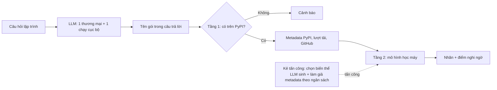

# Đề xuất chốt: Input, Output và phạm vi nghiên cứu

**Đề tài:** Tăng cường độ bền vững adversarial cho hệ thống phát hiện tấn công Slopsquatting (Package Hallucination) trong mã nguồn sinh bởi mô hình ngôn ngữ lớn

**Gửi:** TS. Mai Đức Thọ · **Ngày:** 09/11/2026 · **Căn cứ:** [thiet-ke-du-lieu.md](thiet-ke-du-lieu.md), [bao-cao-thu-nghiem-pilot.md](bao-cao-thu-nghiem-pilot.md), [huong-dan-trien-khai.md](huong-dan-trien-khai.md)

Tài liệu này đề xuất chốt ba điều: bài toán đầu vào/đầu ra, đầu vào/đầu ra của từng thành phần, và sản phẩm cuối của bài báo. Mục 4 là các điểm em cần thầy duyệt.

## 1. Bài toán

**Đầu vào:** tên một gói Python mà LLM gợi ý trong mã nguồn, cùng metadata của gói trên PyPI (nếu gói đã tồn tại).

**Đầu ra:** nhãn {an toàn, đáng ngờ} và điểm nghi ngờ trong [0, 1], với ngưỡng đặt sao cho chỉ báo nhầm 1 trên 100 gói thật.

**Câu hỏi nghiên cứu:** bộ phát hiện này bị né dễ đến mức nào khi kẻ tấn công chỉ được dùng **đúng các tên mà LLM gợi ý** và chỉ làm giả metadata **trong một ngân sách**, và phòng thủ thế nào cho bền.

## 2. Input và output theo từng thành phần

| # | Thành phần | Input | Output | Chỉ số kiểm tra |
| --- | --- | --- | --- | --- |
| M1 | Sinh dữ liệu | 18.074 câu hỏi Python (Spracklen và cộng sự) + bộ câu hỏi mới; 2 LLM | Mỗi câu trả lời: mã nguồn, danh sách tên gói, nhãn có/không trên PyPI | Tỷ lệ tên bịa; số tên bịa không trùng; tỷ lệ tách tên sai (kiểm tra tay 100 tên, ≤ 10%) |
| M2 | Bộ biến thể | 500 tên bịa và câu hỏi gốc; hỏi lại 10 lần mỗi LLM | Mỗi câu hỏi: mọi tên sinh ra và tần suất; trạng thái đăng ký được theo quy tắc `ultranormalize` của PyPI | Số biến thể bịa đăng ký được trên mỗi câu hỏi |
| M3 | Gắn metadata | Tên có trên PyPI | 15 đặc trưng: 12 từ PyPI (tuổi gói, số bản phát hành, link repo…) + lượt tải 90 ngày + sao GitHub + URL được xác minh | Tỷ lệ gói có đủ metadata (≥ 95%) |
| M4 | Bộ phát hiện tầng 1 (chỉ tên) | Chuỗi tên gói | Điểm nghi ngờ | AUC, TPR@1%FPR, kiểm thử chéo giữa 2 LLM |
| M5 | Bộ phát hiện tầng 2 (tên + metadata) | Tên + 15 đặc trưng | Điểm nghi ngờ | Như M4, cộng FPR trên gói mới ≤ 60 ngày |
| M6 | Tấn công thực tế | Bộ phát hiện M5; bộ biến thể M2; bảng chi phí làm giả metadata | Tỷ lệ né có trọng số tần suất (RER) theo ngân sách (ngày chờ, USD) | Đường RER theo ngân sách |
| M7 | Mốc tấn công tự do | CharCNN (M4); ngân sách sửa *k* ký tự | Tỷ lệ né khi tự do sửa tên (HotFlip, Faster-GCG) | Chênh lệch giữa tỷ lệ này và RER thực tế |
| M8 | Phòng thủ | Dữ liệu huấn luyện + biến thể M2 + metadata giả | Bộ phát hiện bền vững | RER giảm ≥ 50%; FPR trên gói mới ≤ 2% |

### Ví dụ một bản ghi

**Đầu vào của M4/M5 (một hàng trong bộ dữ liệu):**

| Trường | Ví dụ | Ghi chú |
| --- | --- | --- |
| `name` | `vector-cache` | Đã chuẩn hóa theo PEP 503 |
| `llm`, `question_id`, `frequency` | `qwen2.5-coder-7b`, `4182`, `7/10` | Nguồn gốc và tần suất LLM gợi ý |
| `on_pypi` | `1` | Kết quả tầng 1 |
| `age_days`, `n_releases`, `has_repo`, `downloads_90d`, … | `21`, `1`, `0`, `35`, … | Metadata, chỉ có khi `on_pypi = 1` |
| `label` | `halluc_registered` | Một trong: tên thật / tên bịa chưa đăng ký / tên bịa đã bị đăng ký / bản giữ chỗ / gói độc hại |

**Đầu ra của M5:** `{"name": "vector-cache", "score": 0.93, "decision": "suspicious", "threshold": 0.71}`.

**Đầu ra của M6, một điểm trên đường RER:** `{"budget_days": 30, "budget_usd": 50, "RER": 0.42, "ci95": [0.37, 0.47]}`.

## 3. Sản phẩm cuối của bài báo

| Sản phẩm | Nội dung | Tính mới |
| --- | --- | --- |
| Mô hình kẻ tấn công và thước đo RER | Ba điều kiện né: tên là biến thể LLM thật sự gợi ý, đăng ký được trên PyPI, không bị phát hiện sau khi làm giả metadata trong ngân sách | Chưa có trong các công trình đã khảo sát: MeMPtec chia đặc trưng dễ/khó làm giả nhưng không ràng buộc tên theo LLM; các nghiên cứu tấn công tên đều giả định tự do sửa ký tự |
| Bộ biến thể tên bịa theo câu hỏi, có tần suất | 500 tên × 10 lần hỏi lại × 2 LLM | Spracklen và cộng sự đo mức lặp lại nhưng không công bố dữ liệu |
| Kết quả định lượng 3 câu hỏi nghiên cứu | Bảng và đồ thị có khoảng tin cậy 95% | — |
| Bộ phát hiện bền vững theo chi phí | So sánh 3 cách phòng thủ | Đánh đổi RER và báo nhầm gói mới |
| Mã nguồn và số liệu tổng hợp | Công khai; danh sách tên đầy đủ chỉ cấp theo yêu cầu sau khi báo PyPI Security | — |

**Kết quả sơ bộ đã có (pilot, dữ liệu công khai):**

- Làm giả metadata rẻ đã né được 80,3% bộ phát hiện tầng 2.
- Tự do sửa 1 ký tự né được 94,4%, nhưng 0% trùng tên LLM thật sự sinh.
- Kiểm thử chéo LLM làm TPR@1%FPR giảm từ 0,548 xuống 0,232.

Chi tiết và hạn chế ở [bao-cao-thu-nghiem-pilot.md](bao-cao-thu-nghiem-pilot.md).

## 4. Các điểm em đề nghị thầy duyệt

| # | Điểm cần chốt | Đề xuất | Phương án thay thế |
| --- | --- | --- | --- |
| 1 | Hệ sinh thái | Chỉ PyPI | PyPI + npm (tăng gấp đôi khối lượng) |
| 2 | LLM | Qwen2.5-Coder-7B chạy cục bộ (nguồn dữ liệu chính) + Claude Haiku 5.5 qua Batch API; chỉ chuyển sang GPT mini nếu Haiku ngoại suy được < 500 tên bịa không trùng | Thêm LLM thứ ba nếu còn ngân sách |
| 3 | Đơn vị đếm | Tên không trùng (chuẩn hóa PEP 503) | Đếm theo lượt gợi ý (như Spracklen) — báo cả hai |
| 4 | Chỉ số chính | TPR@1%FPR (bộ phát hiện) và RER theo ngân sách (tấn công) | Precision/Recall/F1 chỉ báo phụ |
| 5 | Tập giữ riêng để đặt ngưỡng | ≥ 1.521 tên thật do LLM gợi ý | — |
| 6 | Mô hình | Tầng 1: LR char n-gram + CharCNN; tầng 2: Random Forest (chính), XGBoost (đối chứng); thử thêm fastText, CodeBERT | Chốt cuối theo quy tắc chọn ghi sẵn ở [huong-dan-trien-khai.md](huong-dan-trien-khai.md), bước 1.5 |
| 7 | Tấn công chính | Chọn biến thể LLM sinh + làm giả metadata (chỉ mô phỏng) | Faster-GCG giữ vai trò mốc so sánh |
| 8 | Điểm quyết định hướng bài | Nếu trung bình < 2 biến thể đăng ký được mỗi câu hỏi, trọng tâm chuyển sang "tấn công thực tế khó hơn giả định" | — |
| 9 | Nơi gửi bài | ACM AISec hoặc ACSAC; dự phòng tạp chí *Computers & Security* | — |
| 10 | Ngân sách | GPU thuê khoảng 5–20 USD; LLM thương mại khoảng 2,4 USD (Claude Haiku 5.5 qua Batch API, chỉ in code, dừng sớm) hoặc theo giá mô hình dự phòng | — |

## 5. Việc tuần này

| Ngày | Việc | Sản phẩm |
| --- | --- | --- |
| Thứ 2–3 | Gửi tài liệu này, nhận ý kiến về mục 4 | Danh sách điểm đã chốt |
| Thứ 3–5 | Chạy thử 2.000 câu trên Qwen, 500 câu trên Claude Haiku 5.5 (GPT mini chỉ khi Haiku không đạt) | Tỷ lệ tên bịa, số tên không trùng, chi phí thực tế |
| Thứ 6 | Chốt LLM thương mại và quy mô; cập nhật kế hoạch | Bảng so sánh ứng viên, quyết định |
