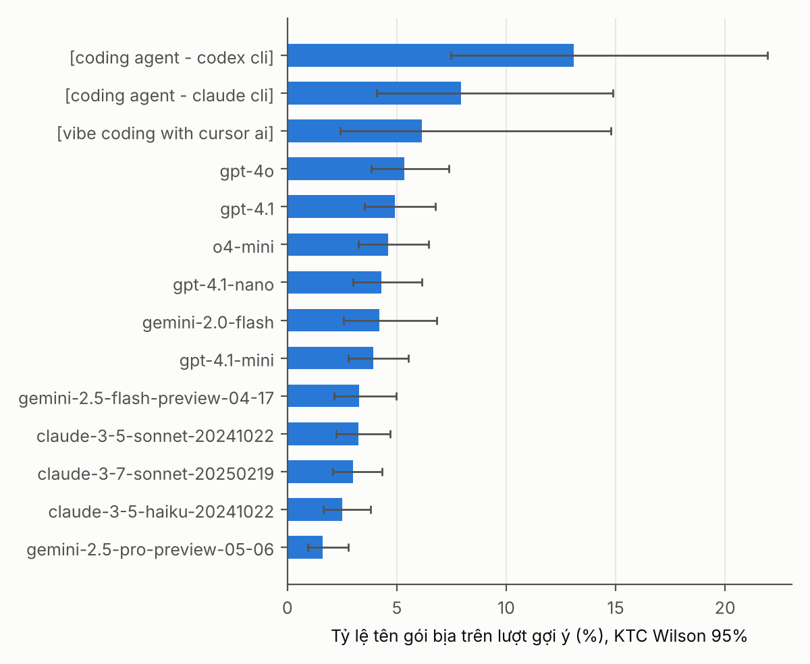
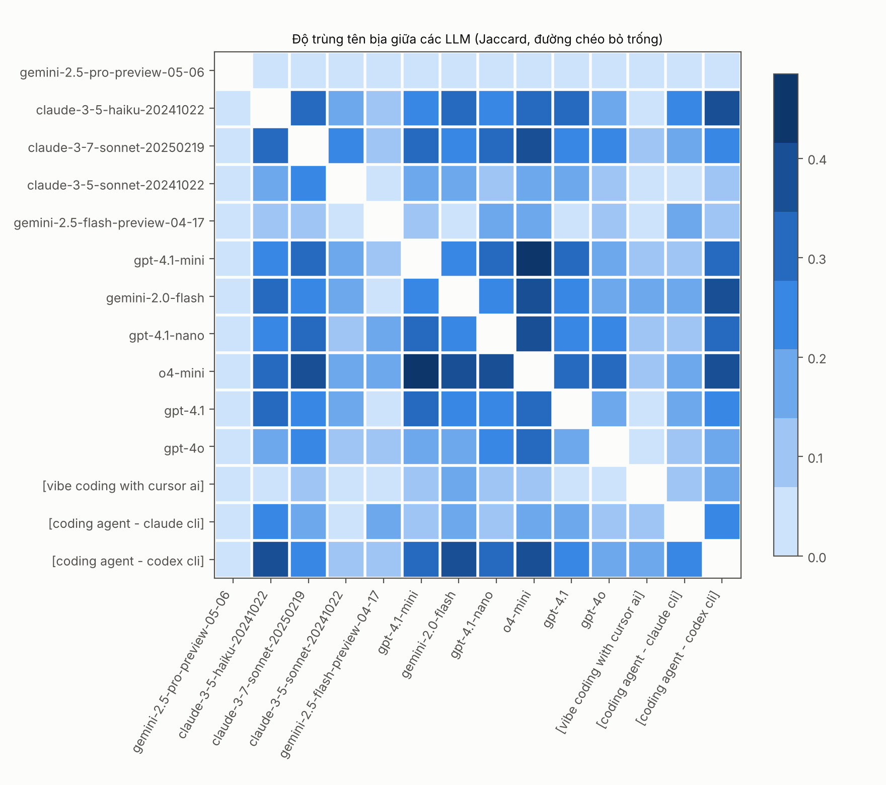

# Mở rộng số LLM và trực quan hóa so sánh

**Ngày:** 10/11/2026 · **Liên quan:** [huong-dan-trien-khai.md](huong-dan-trien-khai.md), [de-xuat-chot-input-output.md](de-xuat-chot-input-output.md) · **Mã:** [`experiments/compare/compare_models.py`](../../experiments/compare/compare_models.py)

Tài liệu đề xuất thêm LLM theo từng tầng để kết quả rộng hơn, nhưng vẫn tiết kiệm token. Phần dữ liệu chính vẫn chạy trên hai LLM đã chốt; các LLM thêm chỉ chạy trên **một tập câu hỏi chung nhỏ** để so sánh.

## 1. Danh sách LLM theo tầng

| Tầng | LLM | Số câu hỏi | Chi phí token | Trả lời câu hỏi gì |
| --- | --- | ---: | --- | --- |
| **A. Bắt buộc** | Qwen2.5-Coder-7B-Instruct (chạy cục bộ) | 18.074 + hỏi lại 500 tên | 0 (chỉ thuê GPU) | Nguồn dữ liệu chính |
| | Claude Haiku 5.5 (Batch API) | Dừng sớm khi đủ 500 tên + hỏi lại 250 tên | Khoảng 2,4 USD | LLM thương mại chính |
| **B. Mở rộng, chạy cục bộ** | DeepSeek-Coder-6.7B-Instruct | 2.000 câu chung | 0 | So sánh theo thời gian: Spracklen và cộng sự đã đo họ DeepSeek Coder năm 2024 |
| | CodeLlama-7B-Instruct | 2.000 câu chung | 0 | Cùng mục đích; thêm một họ mô hình khác |
| | Qwen2.5-Coder-32B-Instruct (lượng tử hóa 4-bit) | 2.000 câu chung | 0 | Ảnh hưởng của kích thước mô hình (7B so với 32B, cùng họ) |
| **C. Mở rộng, thương mại** | Claude Sonnet 5.5 | 500 câu chung | Khoảng 1 USD (Batch; 2 / 10 USD mỗi 1 triệu token vào/ra) | Ảnh hưởng kích thước trong cùng họ (Haiku so với Sonnet) |
| | GPT mini (OpenAI) | 500 câu chung | Tính theo giá hiện hành | Họ mô hình có tỷ lệ bịa cao nhất theo Churilov (2026); cũng là phương án dự phòng |
| | Gemini Flash | 500 câu chung | Tính theo giá hiện hành | Họ mô hình thứ ba |
| **D. Không chạy** | Coding agent (Codex CLI, Claude CLI, Cursor) | — | Rất cao (agent dùng nhiều token mỗi tác vụ) | Trích số liệu có sẵn của Trend Micro (mục 3) |

**Nguyên tắc tiết kiệm token:**

- Mọi LLM dùng **cùng thứ tự câu hỏi đã xáo cố định**, nên `--limit 500` hoặc `--limit 2000` cho ra đúng cùng một tập câu hỏi. So sánh là theo cặp (cùng câu hỏi), cần ít mẫu hơn so với hai tập khác nhau.
- Tầng B không tốn tiền token; chạy trên cùng máy GPU đã thuê cho Qwen 7B.
- Tầng C chỉ chạy 500 câu, có thể bỏ từng mô hình mà không ảnh hưởng phần chính.
- Kiểm tra lại mã mô hình trên HuggingFace và trang của nhà cung cấp trước khi chạy; ghi đúng mã đã gọi vào bài.

Thêm một LLM mới chỉ cần chạy `generate.py` hoặc `generate_claude_batch.py` với mã mô hình mới. Script so sánh tự nhận mọi file đầu ra.

## 2. Hình và bảng tự động sinh

```bash
python ../experiments/compare/compare_models.py figs ext/own/*.jsonl --detect
```

| Đầu ra | Nội dung | Dùng trong bài |
| --- | --- | --- |
| `model_summary.csv` | Mỗi LLM: số câu, số lượt gợi ý, tỷ lệ tên bịa và KTC Wilson 95%, số tên bịa không trùng, tên bịa trên 1.000 câu | Bảng mô tả dữ liệu |
| `fig_halluc_rate.png` | Thanh ngang tỷ lệ tên bịa theo LLM, có thanh sai số | Hình 1 |
| `fig_jaccard.png`, `jaccard.csv` | Ma trận độ trùng tên bịa giữa các cặp LLM | Hình 2: tên nào nhiều LLM cùng bịa là mục tiêu ưu tiên của kẻ tấn công |
| `fig_cross_llm.png`, `cross_llm.csv` | Ma trận phát hiện chéo: huấn luyện trên LLM hàng, kiểm thử trên LLM cột, TPR@1%FPR, chỉ dùng tên chưa thấy khi huấn luyện | Hình 3: minh họa giả thuyết H1 |

Hình 3 chỉ được vẽ khi có ít nhất hai LLM đạt ≥ 30 tên bịa và ≥ 150 tên thật. Với 2.000 câu hỏi, các LLM tầng A và B dự kiến đạt; tầng C với 500 câu có thể không đạt.

## 3. Chạy thử trên dữ liệu có sẵn (Trend Micro, 14 LLM và agent, 100 câu hỏi chung)

Để kiểm tra script và hình, mình chạy trên dữ liệu công khai của Trend Micro: 14 LLM và agent, cùng 100 câu hỏi. Đây chỉ là minh họa: mỗi LLM có 100 câu nên khoảng tin cậy rộng.





Quan sát:

- **Tỷ lệ tên bịa** của LLM gọi trực tiếp nằm trong khoảng 1,6% (gemini-2.5-pro) đến 5,3% (gpt-4o).
- **Ba chế độ agent cao hơn** (6,2–13,1%), nhưng mỗi agent chỉ có 65–101 lượt gợi ý nên khoảng tin cậy rất rộng (ví dụ Codex CLI: 7,5–22,0%). Chưa đủ để kết luận agent bịa nhiều hơn.
- **Độ trùng giữa các LLM** trung bình 0,17 (Jaccard). Cặp trùng nhiều nhất là gpt-4.1-mini và o4-mini (0,48). gemini-2.5-pro gần như không trùng với LLM nào.
- **Hệ quả cho bài báo:** tên bịa không hoàn toàn riêng cho từng LLM. Nhóm tên nhiều LLM cùng bịa là bề mặt tấn công chung, khớp với 127 tên mà Churilov (2026) thấy cả 5 LLM cùng bịa. Hình 2 trên dữ liệu thật của đề tài sẽ cho biết nhóm này lớn đến đâu.
- Ma trận phát hiện chéo không vẽ được trên dữ liệu này vì mỗi LLM chỉ có 4–31 tên bịa.

Số liệu: [`model_summary.csv`](../../experiments/compare/demo_trendmicro/model_summary.csv), [`jaccard.csv`](../../experiments/compare/demo_trendmicro/jaccard.csv).

## 4. Lệnh chạy tầng mở rộng

Tầng B, trên máy GPU, sau khi xong Qwen 7B (đổi `<mô-hình>` và tên file):

```bash
vllm serve deepseek-ai/deepseek-coder-6.7b-instruct --port 8000
```

```bash
LLM_BASE_URL=http://localhost:8000/v1 LLM_MODEL=deepseek-ai/deepseek-coder-6.7b-instruct python ../experiments/collect/generate.py gen --prompts prompts.txt --index simple.json --out ext/own/ext_deepseek.jsonl --limit 2000
```

Tầng C với Claude Sonnet 5.5:

```bash
python ../experiments/collect/generate_claude_batch.py submit-gen --model claude-sonnet-5-5 --prompts prompts.txt --limit 500 --manifest sonnet.manifest.json
```

```bash
python ../experiments/collect/generate_claude_batch.py collect --manifest sonnet.manifest.json --index simple.json --out ext/own/ext_sonnet.jsonl
```

## 5. Thứ tự ưu tiên nếu thiếu thời gian

1. Tầng A (bắt buộc).
2. DeepSeek-Coder-6.7B: không tốn token, cho phép so sánh với Spracklen và cộng sự.
3. Claude Sonnet 5.5: khoảng 1 USD, cho phép so sánh kích thước trong cùng họ.
4. Qwen2.5-Coder-32B, CodeLlama, GPT mini, Gemini Flash.
