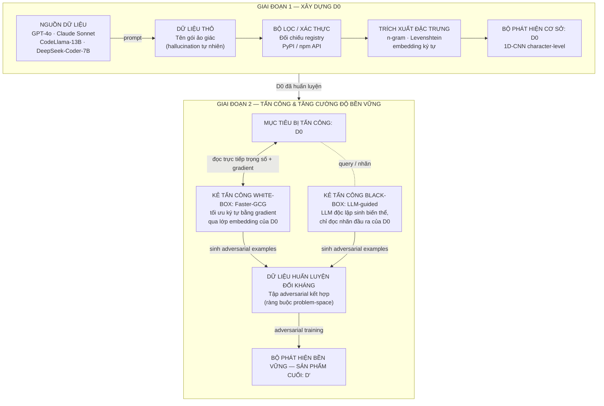

# Kiến trúc phương pháp: Slopsquatting Detection

> Dựng lại dạng markdown và sơ đồ Mermaid từ ảnh `architecture.png` (Google Drive, sửa lần cuối 10/09/2026). Chữ trong sơ đồ được lấy từ ảnh gốc; bố cục được vẽ lại, nên xem ảnh gốc nếu cần đúng hình thức trình bày.

## Faster-GCG nằm ở đâu trong kiến trúc bài toán

Faster-GCG chỉ xuất hiện ở Giai đoạn 2, và chỉ trên một trong hai nhánh tấn công — nhánh cần truy cập trực tiếp vào gradient của D0. Sơ đồ dưới đây bám theo đúng luồng dữ liệu của đề cương, từ lúc D0 được huấn luyện đến lúc D′ ra đời.

Sau khi có D′, cả hai kỹ thuật tấn công được chạy lại trên D′ để đánh giá lại ASR và FPR.

**Chú thích:**

- D0 / D′ — bộ phát hiện.
- Đường liền: Faster-GCG (white-box), đọc trực tiếp trọng số và gradient.
- Đường đứt: LLM-guided (black-box), chỉ trao đổi qua truy vấn/nhãn, không đọc nội bộ.

Hai kẻ tấn công có threat model khác nhau nhưng cùng một mục tiêu là D0. Faster-GCG là nhánh bên trái của Giai đoạn 2, thành phần duy nhất trong toàn bộ kiến trúc đọc trực tiếp trọng số và gradient của D0 (đường nối liền, hai chiều). Nhánh LLM-guided bên phải chỉ trao đổi qua truy vấn/nhãn (đường nối đứt), đúng ranh giới white-box / black-box đã định nghĩa trong Threat Model. Cả hai nhánh gộp lại thành một tập adversarial duy nhất để huấn luyện D′, sau đó D′ được đưa trở lại đánh giá bằng chính hai kỹ thuật này.

## Vị trí chính xác của Faster-GCG

Faster-GCG không phải một bước độc lập trong pipeline. Nó là công cụ tấn công gắn trực tiếp vào D0, tái sử dụng chính lớp embedding ký tự đã được huấn luyện ở Giai đoạn 1 (mục 3.1 đề cương). Nó chỉ tồn tại sau khi D0 đã có trọng số cụ thể, và biến mất khỏi sơ đồ ngay khi D′ được huấn luyện xong. Vai trò của nó là sinh ra tập adversarial examples để đưa vào bước adversarial training, không phải một module chạy song song lâu dài trong hệ thống triển khai thực tế.

Điều này giải thích vì sao Faster-GCG không xuất hiện ở tầng triển khai API Gateway (mục 3.4 đề cương): tại đó chỉ có D′ chạy suy luận, còn Faster-GCG chỉ chạy một lần trong giai đoạn nghiên cứu để tạo dữ liệu huấn luyện đối kháng.
